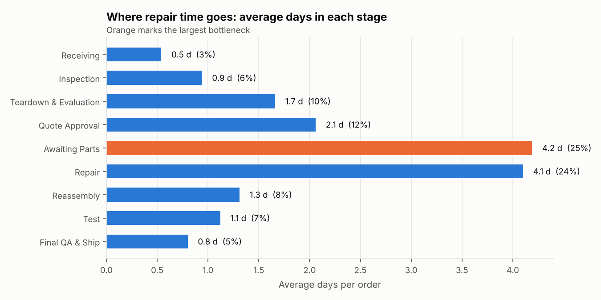
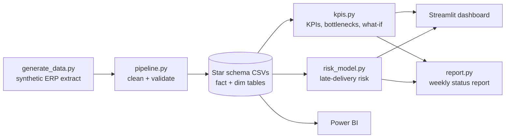
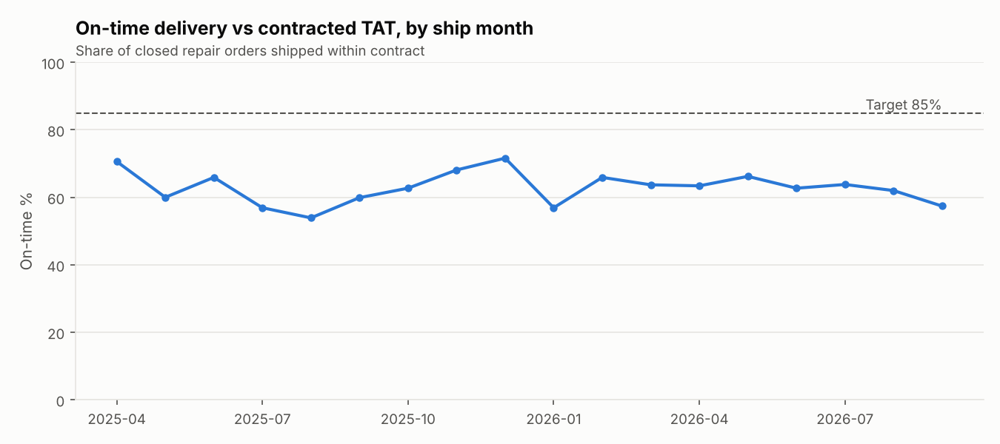
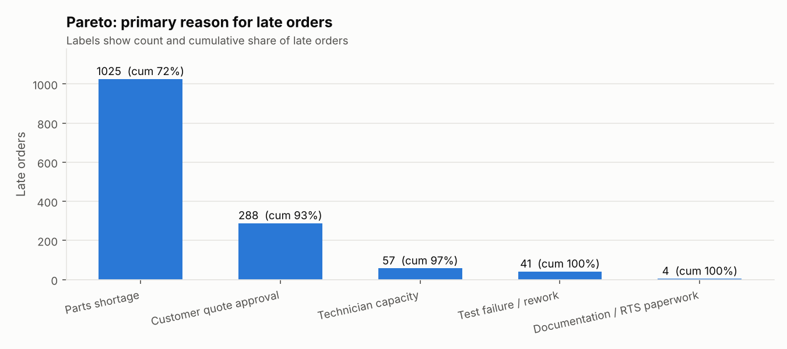
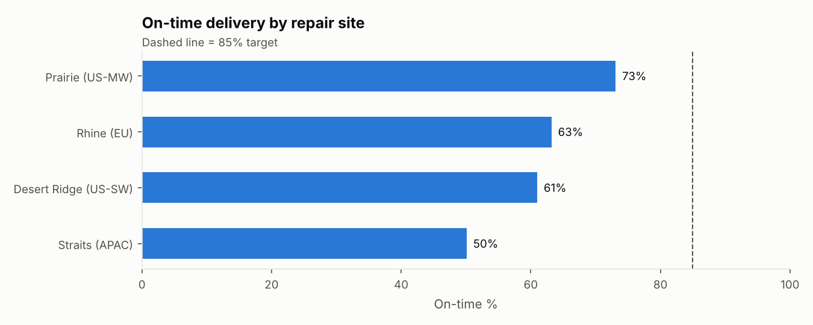

# Aerospace Repair and Overhaul: Turnaround Time (TAT) Analytics

An end-to-end IT business analysis and digital transformation project for an aerospace component repair station: from business requirements and process mapping, through a cleaned data model and Power BI-ready star schema, to an interactive dashboard, a late-delivery risk model, what-if analysis for improvement initiatives, and an automated weekly stakeholder report.

> **Data note:** all data is synthetic and generated by `tat_analytics/generate_data.py`. It is modeled on publicly described repair station dynamics (parts shortages, customer quote approvals, test failures, AOG expediting). No company data is used.



### [Open the live dashboard](https://alexagonzalestuesta.github.io/aero-repair-tat-analytics/)

Loads in about a second, no sign-up. Filter by site, part family and priority, see which open orders are at risk, and test improvement scenarios with sliders. Synthetic data only.

## Business problem
Aerospace repair stations commit to a contracted turnaround time for every unit they repair. Late units can leave aircraft on the ground, trigger contract penalties, and damage customer relationships. Leaders need to know **where repair time goes, which open orders will be late, and which improvements are worth funding**.

## Key findings (from the current dataset)
| Finding | Result |
|---|---|
| On-time delivery vs 85% target | **62.7%** (Red) |
| Largest bottleneck | **Awaiting Parts**, 4.2 days per order, 25% of total TAT |
| Top root cause of late orders | **Parts shortage**, 72% of late orders |
| Lowest-performing site | **Straits (APAC)**, 50% on-time |
| Late-penalty exposure | **$6.27M** over the period |
| Risk model on held-out recent orders | ROC AUC **0.75**; top 10% of scores are **2x** more likely to be late |
| Three initiatives combined (what-if) | On-time **62.7% to 76.8%**, **$3.66M** penalties avoided |

Full write-up: [`outputs/weekly_status_report.md`](outputs/weekly_status_report.md)

## What this project demonstrates
| Skill | Where |
|---|---|
| Business analysis: requirements, user stories, acceptance criteria, KPI definitions | [`docs/business_requirements.md`](docs/business_requirements.md) |
| Process analysis: current-state and future-state value stream maps | [`docs/process_map.md`](docs/process_map.md) |
| Data review and quality: automated detection and repair of duplicates, inconsistent labels, missing values, impossible timestamps | [`tat_analytics/pipeline.py`](tat_analytics/pipeline.py) |
| Data modeling: star schema for Power BI, plus DAX measures | [`docs/powerbi_guide.md`](docs/powerbi_guide.md) |
| Dashboard development | [`app/dashboard.py`](app/dashboard.py) (Streamlit) |
| Predictive analytics | [`tat_analytics/risk_model.py`](tat_analytics/risk_model.py) |
| Process improvement and business case | What-if scenarios in [`tat_analytics/kpis.py`](tat_analytics/kpis.py) |
| Automation and stakeholder communication | [`tat_analytics/report.py`](tat_analytics/report.py) + weekly GitHub Actions schedule |
| Testing and CI | [`tests/`](tests/), [`.github/workflows/ci.yml`](.github/workflows/ci.yml) |

## Architecture


## How to run
Requires Python 3.10 or newer.

```bash
git clone https://github.com/<your-username>/aero-repair-tat-analytics.git
cd aero-repair-tat-analytics
python -m venv .venv
# Windows: .venv\Scripts\activate    Mac/Linux: source .venv/bin/activate
pip install -r requirements.txt

python run_pipeline.py          # generate data, clean, model, charts, report
pytest                          # run the tests
python site/build_site.py       # build the static dashboard into _site/ (open _site/index.html)
streamlit run app/dashboard.py  # or run the same dashboard as a Streamlit app
```

## Dashboard
The [live dashboard](https://alexagonzalestuesta.github.io/aero-repair-tat-analytics/) is a static page published by `.github/workflows/pages.yml`. On every push, GitHub Actions runs the pipeline and `site/build_site.py` exports one record per repair order; the page recomputes every KPI, chart and what-if result in the browser, and the build fails if those numbers do not match `kpis.py`. The same views also run as a Streamlit app (`app/dashboard.py`).

Filters for site, part family, priority, and date range drive four views:
1. **Performance:** on-time trend against target, on-time % by site and part family.
2. **Bottlenecks:** average and P90 days per stage, late-order Pareto, part numbers with the most parts-wait days.
3. **At-risk open orders:** risk score and band for every open order, downloadable as CSV.
4. **What-if scenarios:** sliders to estimate on-time % and penalty savings from improvement initiatives.

## Charts
| | |
|---|---|
|  |  |
|  |  |

## Recommendations
1. **Safety stock and dual-sourcing** for the chronic shortage part numbers (biggest single lever).
2. **Pre-approved not-to-exceed repair limits** with customers to skip quote waits on routine repairs.
3. **Standard work checklist before Test** to raise first-pass yield and cut rework.
4. **Use the intake risk score** in the daily production meeting to expedite likely-late orders early.

## Project structure
```
aero-repair-tat-analytics/
├── app/dashboard.py            Streamlit version of the dashboard
├── site/                       static dashboard published on GitHub Pages
├── docs/                       BRD, process maps, Power BI guide
├── outputs/                    charts, report, model results (regenerated by run_pipeline.py)
├── tat_analytics/
│   ├── config.py               business assumptions in one place
│   ├── generate_data.py        synthetic repair order generator
│   ├── pipeline.py             data quality rules + star schema
│   ├── kpis.py                 KPIs, bottlenecks, what-if
│   ├── risk_model.py           late-delivery risk model
│   ├── charts.py               static charts
│   └── report.py               automated stakeholder report
├── tests/test_project.py       automated tests
├── run_pipeline.py             one command to run everything
├── .github/workflows/ci.yml    tests + weekly report on GitHub Actions
└── .github/workflows/pages.yml builds and publishes the live dashboard
```

## Author
Alexa Gonzales Tuesta, Purdue University (Business Analytics and Information Management, Marketing; Computer Science minor)
