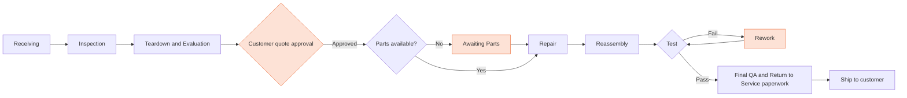
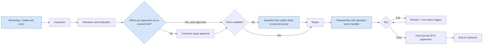

# Repair Value Stream: Current State and Future State

## Current state (as-is)
Red stages are where the data shows the most waiting and rework.

**Pain points found in the data**
1. **Awaiting Parts** is the largest single stage of repair time and the primary cause of most late orders.
2. **Customer quote approval** is the second largest cause of late orders, worst for defense customers.
3. **Test failures** send units back through repair, adding rework time and hurting first-pass yield.

## Future state (to-be)

| Change | Targets | Owner |
|---|---|---|
| Intake risk score flags likely-late orders on day 1 | Proactive expediting and customer communication | Customer support + repair leads |
| Pre-approved not-to-exceed repair limits | Quote approval wait | Contracts / account managers |
| Safety stock and dual-sourcing for chronic shortage part numbers | Awaiting Parts wait | Supply chain |
| Standard work checklist before Test | Rework and first-pass yield | Repair engineering |
